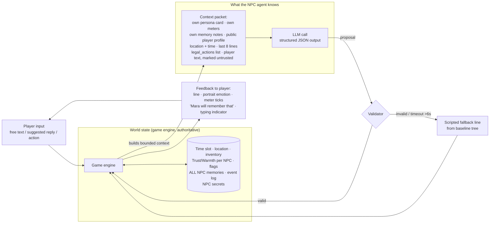

# After Hours — Initial Configuration Document

**Version:** Initial (G1), November 15, 2026, config `v0.1-proposed`
**Owner:** Ava Ferrentino, Tech Lead role, Creative Director approval retained
**Gate Approver:** Instructor
**Status:** Everything below is **proposed**: nothing is implemented or verified yet. Labels: **[DECISION]** (mine), **[RECOMMENDATION]** (from a production agent, not yet accepted), **[OPEN]** (with a decide-by date).
**Machine-readable manifest:** [`agent-config.json`](../agent-config.json), using the course `schema_version: "course-1"` format.

---

## Part A — In-game agent: NPC dialogue agent

### A1. Purpose
Voice one NPC (Mara, Jun or Nico) in a conversation. Each turn it returns one in-character line and *proposes* an emotion, at most one action, a relationship change and at most one memory note. **The game owns every state change;** the agent only proposes.

### A2. Systems diagram: world state vs. agent knowledge



**Knowledge boundary.** The agent never sees other NPCs' memories or meters, events it didn't witness, the flags it can't act on, its own secret's unlock threshold, or anything else in the world state outside the context packet. Its secret is in its persona card, so the model *knows* it. Revealing it is the `share_secret` action, which the validator allows only when Trust ≥ 3. [OPEN: a model can still leak the secret in plain dialogue. Test case ADV-07 checks for this. If it leaks, remove the secret text from context until the action is legal.]

### A3. Context sources (named)
| Source | Content | Size budget |
|---|---|---|
| `npcs/<id>/persona.md` | Voice, wants, fears, secret, three "never says" lines | ~800 tokens |
| `state.npc[<id>].memories` | Up to 12 notes, newest first | ~400 tokens |
| `state.npc[<id>].meters` | Trust and Warmth | ~20 tokens |
| `state.player.public` | Name, pronouns, background, trait | ~50 tokens |
| `state.scene` | Location and time slot | ~30 tokens |
| `state.conversation[-8:]` | The last 8 lines of this conversation | ~500 tokens |
| `engine.legal_actions(npc)` | Actions legal this turn | ~50 tokens |
| Player text | **Treated as untrusted input**, at most 300 characters | ~100 tokens |

Target input is about 2,000 tokens per turn.

### A4. Actions and output schema
```json
{
  "line": "string, ≤ 280 chars, in character",
  "emotion": "warm | guarded | amused | hurt | angry | neutral",
  "action": "none | offer_job | share_secret | give_item | ask_favor | refuse | end_conversation",
  "relationship_delta": { "trust": "-2..2", "warmth": "-2..2" },
  "memory_note": "string ≤ 120 chars, or null",
  "cited_memory_ids": ["ids of memory notes this line refers to"]
}
```

### A5. Validation (game-side, deterministic)
1. The output parses and matches the schema. Otherwise retry once, then fall back.
2. `action` must be in `legal_actions` for this turn. Otherwise the action becomes `none`, the line is kept, and the rejection is logged.
3. `relationship_delta` is clamped to ±2 per turn and ±3 per conversation.
4. Every `cited_memory_ids` entry must exist in *this* NPC's memory list. Otherwise the line is rejected and the game falls back, because a phantom memory breaks Pillar 1.
5. `memory_note` must be 120 characters or fewer. The memory list is capped at 12 notes and drops the oldest.
6. A persona-break and safety filter rejects lines that mention being an AI or a model, contain system-prompt text, or include unsafe content. Then retry once and fall back.

### A6. Memory policy
Memory is per NPC and per playthrough, and stored only in the game state. **Nothing persists after the session ends.** Notes are written only from validated `memory_note` proposals. No other NPC can read them. [OPEN: whether to add a summary pass at the end of each conversation. It is budgeted in A9 but optional.]

### A7. Model and settings
- **Planned:** Claude Haiku 5.5 (`claude-haiku-5-5`), with structured output, `max_tokens` 400 and low effort. [DECISION pending, by Nov 18.]
- **Alternatives:** the course default, Gemini Flash-Lite via Vertex AI, or a more capable model (Claude Sonnet 5.5) if character quality is weak. The model ID is set explicitly through `COURSE_MODEL`, never switched silently, and the resolved ID is logged.
- **System instructions:** `npc_agent/prompts/system.md` (to be written). The persona card is inserted in a fixed position so the prefix can be cached.

### A8. Failure modes (named)
| Failure | Detection | Response |
|---|---|---|
| Timeout over 6 s, or a provider error or quota limit | Timer, error type | Scripted fallback line, logged |
| Invalid JSON or schema | Parser | Retry once, then fall back |
| Illegal action | `legal_actions` check | Action becomes `none`, logged |
| Phantom memory (cites a memory that doesn't exist) | ID check | Fall back, logged |
| States an unwitnessed event as fact | Adversarial suite plus human review of traces | Tighten the prompt; QA regression case |
| Leaks its secret before Trust ≥ 3 | ADV-07 | Remove the secret from context until the action is legal |
| Persona break or prompt injection | Filter plus the adversarial suite | Retry, then fall back |
| Bland or generic replies | Playtest and BI review | Tune the persona card, or try a larger model |

### A9. Budgets

**Latency (per NPC turn).** Basis: a small, fast model, about 2,000 input tokens and about 150 output tokens, with the reply streamed. These numbers are **not yet measured**. The first experiment measures them, and the course setup check already reports latency.
| Measure | Target |
|---|---|
| First visible text (streamed) | p50 ≤ 1.5 s |
| Complete line | p95 ≤ 3.0 s |
| Hard timeout, then fallback | 6.0 s |
| Fallback rate in playtests | ≤ 5% of turns |

**Cost.** Basis: Claude Haiku 5.5 list price, $0.10 per million input tokens and $0.50 per million output tokens.
| Item | Tokens | Cost |
|---|---|---|
| One dialogue turn | 2,000 in + 150 out | $0.000275 |
| Conversation-end memory summary (optional) | 1,500 in + 200 out | $0.00025 |
| **One session** (6 conversations × about 6 turns, so about 40 turns with retries, plus 6 summaries) | about 92K in, 7.2K out | **about $0.013** |
| Hard limits per session | 60 live calls, then scripted mode | ceiling **$0.05** |
| Prototype total through G2/G3 (about 2,000 development turns, a 300-case evaluation, about 30 playtest sessions) | — | about $1.00 estimated; **cap $10** |

The $10 cap leaves room to switch to Claude Sonnet 5.5 ($2 / $10 per million tokens, about 20× the cost, so about $0.25 per session) if Haiku's characterization is too weak.

### A10. Logging
For each turn: model ID, latency, input and output tokens, validator result, fallback flag, and action. Player text is logged **only in playtest builds, with consent,** under an anonymous participant ID. No credentials are ever logged.

### A11. Human override
The player can quit or leave a conversation at any time. A **mode switch** (agent or scripted) is set per session by the tester. A developer flag forces fixture or fallback mode.

### A12. Evaluation (planned)
| Suite | Kind | Cases | Pass condition |
|---|---|---|---|
| `tests/test_validator.py` | Deterministic | 15+ (illegal actions, bad deltas, phantom IDs, oversized fields) | 100% |
| `tests/test_fallback.py` | Deterministic (forced timeout, forced bad JSON) | 4 | Turn state preserved, scripted line shown, fallback logged |
| `evals/adversarial/` | Live, budgeted | 20 (injection, out-of-knowledge questions, secret extraction, persona break) | ≥ 95% handled, with every failure recorded |
| `evals/callbacks/` | Live, budgeted | 20 scripted multi-turn conversations | NPC correctly references a stored memory when relevant in ≥ 80% of cases (rubric checked against my own judgment) |
| Human playtest | Observation | See A13 | — |

### A13. Agent hypothesis and playtest question
- **Hypothesis:** an NPC agent that recalls specific things the player said or did, and acts only through validated relationship actions, will make players feel their relationships are their own, more than an authored branching-dialogue version of the same NPCs does.
- **Scripted baseline:** the same three NPCs, actions, meters, thresholds and endings, with authored menu dialogue (four options per node) and about three authored callbacks per NPC. This is also the fallback.
- **Playtest question:** *When an NPC brings up something the player did earlier, does the player treat it as part of the relationship (following up, changing approach or coming back later) more often than with authored callbacks?*
- **Procedure:** 4–6 external players each play two short nights (3 slots each), one in each mode, with the order alternated between players. Afterward I ask, without leading: "Tell me about [NPC]," then "Did anyone react to something specific you did?", then a 1–7 rating of "This character was responding to me specifically."
- **Measures:** unprompted return visits; the share of free-text replies that refer to earlier events; specific moments recalled; the rating; fallback rate; latency.
- **What would challenge it:** players recall no more specific moments in agent mode than in scripted mode, or spend agent mode probing the AI instead of relating to the character.
- **What the player loses with the baseline:** responses to their own words, callbacks to *any* earlier moment rather than only pre-flagged ones, and relationships that diverge with small differences in behavior.

---

## Part B — Production agent team: planned role coverage

These are the **production agents** that help me build the game. They are separate from the in-game NPC agent. I keep accountability as Executive Producer and Creative Director; agents recommend, and I decide.

| Role | Executable artifact (planned) | Purpose | Context | Tools / permissions | Outputs → recipient | Evaluation | Human approval boundary |
|---|---|---|---|---|---|---|---|
| **Producer** | `.claude/agents/producer.md` | Keep scope, plan, risks and the PPP consistent | `docs/`, the Asana export | Read and write `docs/` only | Plan and risk updates, cut proposals → me | Plan matches the gate matrix; risks have owners | I accept every scope change; the instructor approves gate changes |
| **Design Lead** | `.claude/skills/playtest-design/SKILL.md` | Loop and balance specs, playtest questions | GDD, playtest log | Read and write `docs/` | Specs and question set → Tech Lead, QA | Questions are observable, not leading | I approve the loop and pillars |
| **Tech Lead / Implementation** | `AGENTS.md` + `CLAUDE.md` | Build the engine, validator and agent interface | Repository, tests | Repository read and write, test commands; no credentials, no merge | Branch, passing tests, change summary → reviewer | CI green; validator tests at 100% | I merge |
| **Narrative** | `.claude/skills/npc-persona/SKILL.md` | Write persona cards and the baseline dialogue tree | GDD Section 6, persona template | Write `npcs/` only | Persona cards and baseline tree → Tech Lead, QA | Persona-consistency checklist | I approve each character |
| **Art Lead** (shared with Narrative) | `docs/art-direction.md` + a prompt or asset checklist | Minimum readable visuals | GDD Section 11 | Write `assets/` and the license log | Portraits and backgrounds → Tech Lead | Section 5.3 review; every asset has a license entry | I approve the style |
| **Audio** (shared) | Asset checklist | One ambient loop per location, UI sounds | Same as Art | Same as Art | Sound files plus licenses | License logged | I approve |
| **QA** | `.claude/agents/npc-boundary-reviewer.md` (modeled on the course `rules-reviewer`) | Independent check of validator, boundary and fallback | Diff, tests, adversarial suite | Read, Grep and Glob only; a fresh context | Findings as [blocking / should fix / note] → me | Finds the seeded defects in a known-bad branch | I decide each finding |
| **BI** | `scripts/summarize_traces.py` + a playtest log template | Turn traces and sessions into measurements | Logs, playtest notes | Read logs; write `reports/` | Latency, cost, fallback rate, recall counts, with stated limits → me, Design | Numbers match the raw logs | I interpret the results |
| **Publishing & Release** | `README.md` run instructions + a release checklist (from G3) | Make a playtester able to run the build | Repository | Write docs | Run instructions → playtesters | A fresh person runs the build from the README | I approve release |

**Executable extension artifact (syllabus requirement):** the NPC agent ships as a **function-calling interface with validated structured output** (`npc_agent/agent.py`), following the course `narrator.py` pattern and described in `agent-config.json`. [OPEN: confirm against the syllabus's exact manifest fields.]

**Coverage at G1:** every role is *planned*. None is configured or evaluated yet. Configurations come first for Tech Lead, QA and Narrative (needed for the first experiment), and for the others by G2/G3.
