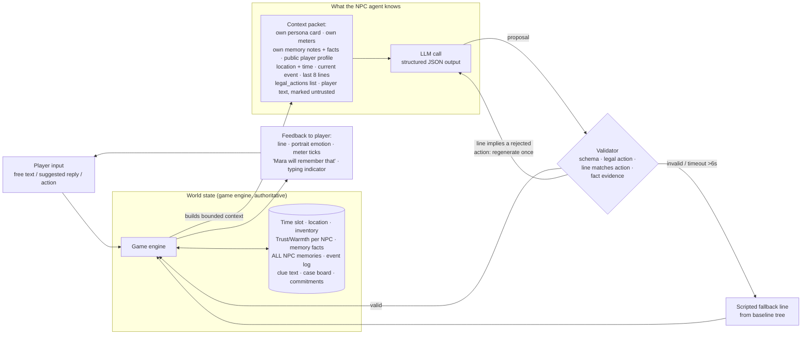

# After Hours — Configuration Document

**Version:** v0.2, November 19, 2026, config `v0.2-proposed`. Revised after G1 Braintrust feedback: dialogue-consistency checks, memory facts that change game state, and the mystery structure (GDD Sections 6–8, 17). The Initial (G1) version is at commit `e29b221`.
**Owner:** Ava Ferrentino, Tech Lead role, Creative Director approval retained
**Gate Approver:** Instructor
**Status:** Everything below is **proposed**: nothing is implemented or verified yet. Labels: **[DECISION]** (mine), **[RECOMMENDATION]** (from a production agent, not yet accepted), **[OPEN]** (with a decide-by date).
**Machine-readable manifest:** [`agent-config.json`](../agent-config.json), using the course `schema_version: "course-1"` format.

---

## Part A — In-game agent: NPC dialogue agent

### A1. Purpose
Voice one NPC (Mara, Jun or Nico) in a conversation. Each turn it returns one in-character line and *proposes* an emotion, at most one action (including revealing a clue or making a commitment), a relationship change, at most one memory note, and at most one **memory fact** (a lie, promise, kindness, flirt or open question that the game acts on). **The game owns every state change;** the agent only proposes. **The dialogue must never get ahead of the game:** a line can't reveal or promise anything the game hasn't approved (A5).

### A2. Systems diagram: world state vs. agent knowledge



**Knowledge boundary.** The agent never sees other NPCs' memories, meters or facts, events it didn't witness, clue unlock thresholds, the truth of the mystery, or anything else in the world state outside the context packet.

**Clues are withheld, not just guarded.** [DECISION, v0.2, after Braintrust feedback that dialogue could reveal what the engine rejects.] The clue's actual content (for Mara, C1: who Rook left with) is **not in the agent's context** until `reveal_clue` is legal. Before that, the persona card says only "you know something about Rook's night that you're not ready to share." When the validator accepts `reveal_clue`, the game shows the **authored clue line** and adds it to the case board, and the agent's next turn includes the clue so it can talk about it. So a clue can't leak early, and the clue the player reads is always the canonical one.

### A3. Context sources (named)
| Source | Content | Size budget |
|---|---|---|
| `npcs/<id>/persona.md` | Voice, wants, fears, relationships (Mara and Nico are partners), three "never says" lines. **No clue text.** | ~800 tokens |
| `state.npc[<id>].memories` | Up to 12 notes, newest first | ~400 tokens |
| `state.npc[<id>].facts` | This NPC's memory facts and open commitments | ~60 tokens |
| `state.event` | The current authored event, if any (setup text and the choices offered) | ~150 tokens |
| `state.npc[<id>].revealed_clue` | The clue text, only after `reveal_clue` was accepted | ~60 tokens |
| `state.npc[<id>].meters` | Trust and Warmth | ~20 tokens |
| `state.player.public` | Name, pronouns, background, trait | ~50 tokens |
| `state.scene` | Location and time slot | ~30 tokens |
| `state.conversation[-8:]` | The last 8 lines of this conversation | ~500 tokens |
| `engine.legal_actions(npc)` | Actions legal this turn | ~50 tokens |
| Player text | **Treated as untrusted input**, at most 300 characters | ~100 tokens |

Target input is about 2,000 tokens per turn.

### A4. Actions and output schema
```json
{
  "line": "string, ≤ 280 chars, in character",
  "emotion": "warm | guarded | amused | hurt | angry | neutral",
  "action": "none | reveal_clue | commit | give_item | ask_favor | hide_player | refuse | end_conversation",
  "commitment": "null, or one of the commitment options in legal_actions, e.g. { \"type\": \"meet\", \"location\": \"rooftop\", \"slot\": \"3am\" }",
  "relationship_delta": { "trust": "-2..2", "warmth": "-2..2" },
  "memory_note": "string ≤ 120 chars, or null",
  "memory_fact": "null, or { \"tag\": \"lied_to | promised | kindness | flirted | asked_openly\", \"detail\": \"≤ 60 chars\", \"evidence\": \"exact quote from the player's last message\" }",
  "cited_memory_ids": ["ids of memory notes this line refers to"]
}
```

**Promises go both ways.** If the NPC promises something ("Meet me on the roof at three"), that must be the `commit` action with a commitment from `legal_actions`. The game then records it and makes the NPC actually show up. If the *player* promises something, the agent proposes a `promised` fact, which the game holds them to.

### A5. Validation (game-side, deterministic)
1. The output parses and matches the schema. Otherwise retry once, then fall back.
2. `action` (and `commitment`, if any) must be in `legal_actions` for this turn. **If it isn't, the whole proposal is rejected,** not just the action, because the line was written assuming the action would happen. The game regenerates once with a note ("that action isn't possible now; don't imply it"), then falls back. [Changed in v0.2: G1 kept the line, which could leave dialogue promising something the game refused.]
3. **The line must match the action.** A deterministic check rejects lines that:
   - name a clue keyword (each clue lists a few, e.g. C3: "Kessler", "lift", "freight") when no clue is being revealed;
   - name a time or meeting place ("at three", "on the roof") when no `commit` is proposed;
   - say the NPC will hide, give or do something when that action isn't proposed.
   Same response as rule 2. The keyword lists are written with the clues and are deliberately broad; false rejections only cost a regeneration.
4. `relationship_delta` is clamped to ±2 per turn and ±3 per conversation.
5. `memory_fact`: the tag must be one of the five, and `evidence` must appear **word for word** in the player's last message. Otherwise the fact is dropped (the line is kept) and logged. This stops the model inventing a lie or promise the player never made. Where the tag needs ground truth (`lied_to`: did the player say something the NPC knows is false?), the persona card lists the NPC's known facts and the fact is accepted only if the agent names which one was contradicted.
6. Every `cited_memory_ids` entry must exist in *this* NPC's memory list. Otherwise the game falls back, because a phantom memory breaks Pillar 1.
7. `memory_note` must be 120 characters or fewer. The memory list is capped at 12 notes and drops the oldest.
8. A persona-break and safety filter rejects lines that mention being an AI or a model, contain system-prompt text, or include unsafe content. Then retry once and fall back.

### A6. Memory policy
Memory is per NPC and per playthrough, and stored only in the game state. **Nothing persists after the session ends.** Notes are written only from validated `memory_note` proposals. **Facts** are written only from validated `memory_fact` proposals, from tagged suggested replies, or from authored event choices, and they are the only memory the game logic reads. No other NPC can read either, except events an NPC witnessed. The endings gallery is the one thing saved between sessions, and it holds ending IDs only, no player text. [OPEN: whether to add a summary pass at the end of each conversation. It is budgeted in A9 but optional.]

### A7. Model and settings
- **Planned:** Claude Haiku 5.5 (`claude-haiku-5-5`), with structured output, `max_tokens` 400 and low effort. [DECISION pending, by Nov 18.]
- **Alternatives:** the course default, Gemini Flash-Lite via Vertex AI, or a more capable model (Claude Sonnet 5.5) if character quality is weak. The model ID is set explicitly through `COURSE_MODEL`, never switched silently, and the resolved ID is logged.
- **System instructions:** `npc_agent/prompts/system.md` (to be written). The persona card is inserted in a fixed position so the prefix can be cached.

### A8. Failure modes (named)
| Failure | Detection | Response |
|---|---|---|
| Timeout over 6 s, or a provider error or quota limit | Timer, error type | Scripted fallback line, logged |
| Invalid JSON or schema | Parser | Retry once, then fall back |
| Illegal action | `legal_actions` check | Action becomes `none`, logged |
| Phantom memory (cites a memory that doesn't exist) | ID check | Fall back, logged |
| States an unwitnessed event as fact | Adversarial suite plus human review of traces | Tighten the prompt; QA regression case |
| Line reveals a clue or promises something the game didn't approve | Rules 2–3; `evals/consistency/` | Regenerate once, then fall back; clue text withheld from context |
| Invents a lie or promise the player didn't make | Evidence-quote check (rule 5) | Drop the fact, log it |
| Misses a real lie or promise (false negative) | `evals/facts/` against my labels | Tune the prompt; suggested replies carry fixed tags as a backstop |
| Persona break or prompt injection | Filter plus the adversarial suite | Retry, then fall back |
| Bland or generic replies | Playtest and BI review | Tune the persona card, or try a larger model |

### A9. Budgets

**Latency (per NPC turn).** Basis: a small, fast model, about 2,000 input tokens and about 150 output tokens, with the reply streamed. These numbers are **not yet measured**. The first experiment measures them, and the course setup check already reports latency.
| Measure | Target |
|---|---|
| First visible text (streamed) | p50 ≤ 1.5 s |
| Complete line | p95 ≤ 3.0 s |
| Hard timeout, then fallback | 6.0 s |
| Fallback rate in playtests | ≤ 5% of turns |

**Cost.** Basis: Claude Haiku 5.5 list price, $0.10 per million input tokens and $0.50 per million output tokens.
| Item | Tokens | Cost |
|---|---|---|
| One dialogue turn | 2,000 in + 150 out | $0.000275 |
| Conversation-end memory summary (optional) | 1,500 in + 200 out | $0.00025 |
| **One session** (4 slots × about 6 turns, plus events and regenerations, so about 32 turns, plus 4 summaries) | about 70K in, 5.6K out | **about $0.010** |
| Hard limits per session | 60 live calls, then scripted mode | ceiling **$0.05** |
| Prototype total through G2/G3 (about 2,000 development turns, a 300-case evaluation, about 30 playtest sessions) | — | about $1.00 estimated; **cap $10** |

The $10 cap leaves room to switch to Claude Sonnet 5.5 ($2 / $10 per million tokens, about 20× the cost, so about $0.20 per session) if Haiku's characterization is too weak.

### A10. Logging
For each turn: model ID, latency, input and output tokens, validator result, fallback flag, and action. Player text is logged **only in playtest builds, with consent,** under an anonymous participant ID. No credentials are ever logged.

### A11. Human override
The player can quit or leave a conversation at any time. A **mode switch** (agent or scripted) is set per session by the tester. A developer flag forces fixture or fallback mode.

### A12. Evaluation (planned)
| Suite | Kind | Cases | Pass condition |
|---|---|---|---|
| `tests/test_validator.py` | Deterministic | 15+ (illegal actions, bad deltas, phantom IDs, oversized fields) | 100% |
| `tests/test_fallback.py` | Deterministic (forced timeout, forced bad JSON) | 4 | Turn state preserved, scripted line shown, fallback logged |
| `tests/test_consistency.py` | Deterministic | 15+ (lines with clue keywords, times, places or offers but no matching action) | 100% rejected |
| `evals/consistency/` | Live, budgeted, **in Experiment 1** | 20 (player pushes for a clue below threshold; asks the NPC to promise to meet; asks to be hidden) | 0 shown lines reveal or promise anything unapproved |
| `evals/facts/` | Live, budgeted, **in Experiment 1** | 30 player messages I've labeled (lies, promises, kindness, flirts, neutral) | ≥ 85% agreement with my labels; 0 facts without valid evidence |
| `evals/adversarial/` | Live, budgeted | 20 (injection, out-of-knowledge questions, clue extraction, persona break) | ≥ 95% handled, with every failure recorded |
| `evals/callbacks/` | Live, budgeted | 20 scripted multi-turn conversations | NPC correctly references a stored memory when relevant in ≥ 80% of cases (rubric checked against my own judgment) |
| Human playtest | Observation | See A13 | — |

### A13. Agent hypothesis and playtest question
- **Hypothesis:** an NPC agent that remembers specific things the player said or did, and turns some of them into validated facts that change the night (clue thresholds, events, endings), will make players feel their own words and choices decided the outcome, more than an authored branching-dialogue version of the same mystery does.
- **Scripted baseline:** the same mystery, NPCs, clues, events, facts, thresholds and endings, with authored menu dialogue (four options per node). Facts are created **only by pre-tagged menu options** (e.g. option B is a lie to Mara). About three authored callbacks per NPC. This is also the fallback.
- **Named outcome memory changes** (from Braintrust feedback): if the player lies to Mara in their own words, she needs Trust ≥ 4 to give C1 and won't hide them when the tail arrives at 2 a.m. In the baseline, only a menu lie does that.
- **Playtest question:** *When a remembered moment changes what an NPC will do, do players connect the outcome to what they said, and change their approach?*
- **Procedure:** 4–6 external players each play two nights, one per mode, order alternated. **To avoid spoiling the second run, the two nights use different truths** (Rook is hiding in a different place, and a different NPC holds each clue). Afterward I ask, without leading: "Why did your night end the way it did?", then "Did anyone react to something specific you did?", then a 1–7 rating of "My own words changed what happened."
- **Measures:** whether players cite a specific moment when explaining the ending; changes of approach after a consequence; free-text replies that refer to earlier events; the rating; replay interest; fallback rate; latency.
- **What would challenge it:** players can't connect outcomes to what they said any better in agent mode, or spend agent mode probing the AI instead of solving the case.
- **What the player loses with the baseline:** their own lies, promises and kindnesses don't count unless I wrote them as an option, so they can't talk their way into or out of anything.

---

## Part B — Production agent team: planned role coverage

These are the **production agents** that help me build the game. They are separate from the in-game NPC agent. I keep accountability as Executive Producer and Creative Director; agents recommend, and I decide.

| Role | Executable artifact (planned) | Purpose | Context | Tools / permissions | Outputs → recipient | Evaluation | Human approval boundary |
|---|---|---|---|---|---|---|---|
| **Producer** | `.claude/agents/producer.md` | Keep scope, plan, risks and the PPP consistent | `docs/`, the Asana export | Read and write `docs/` only | Plan and risk updates, cut proposals → me | Plan matches the gate matrix; risks have owners | I accept every scope change; the instructor approves gate changes |
| **Design Lead** | `.claude/skills/playtest-design/SKILL.md` | Loop and balance specs, playtest questions | GDD, playtest log | Read and write `docs/` | Specs and question set → Tech Lead, QA | Questions are observable, not leading | I approve the loop and pillars |
| **Tech Lead / Implementation** | `AGENTS.md` + `CLAUDE.md` | Build the engine, validator and agent interface | Repository, tests | Repository read and write, test commands; no credentials, no merge | Branch, passing tests, change summary → reviewer | CI green; validator tests at 100% | I merge |
| **Narrative** | `.claude/skills/npc-persona/SKILL.md` | Write persona cards, the mystery bible (truth, clues and keyword lists, events, endings) and the baseline dialogue tree | GDD Section 6, persona template | Write `npcs/` only | Persona cards and baseline tree → Tech Lead, QA | Persona-consistency checklist | I approve each character |
| **Art Lead** (shared with Narrative) | `docs/art-direction.md` + a prompt or asset checklist | Minimum readable visuals | GDD Section 11 | Write `assets/` and the license log | Portraits and backgrounds → Tech Lead | Section 5.3 review; every asset has a license entry | I approve the style |
| **Audio** (shared) | Asset checklist | One ambient loop per location, UI sounds | Same as Art | Same as Art | Sound files plus licenses | License logged | I approve |
| **QA** | `.claude/agents/npc-boundary-reviewer.md` (modeled on the course `rules-reviewer`) | Independent check of validator, boundary and fallback | Diff, tests, adversarial suite | Read, Grep and Glob only; a fresh context | Findings as [blocking / should fix / note] → me | Finds the seeded defects in a known-bad branch | I decide each finding |
| **BI** | `scripts/summarize_traces.py` + a playtest log template | Turn traces and sessions into measurements | Logs, playtest notes | Read logs; write `reports/` | Latency, cost, fallback rate, recall counts, with stated limits → me, Design | Numbers match the raw logs | I interpret the results |
| **Publishing & Release** | `README.md` run instructions + a release checklist (from G3) | Make a playtester able to run the build | Repository | Write docs | Run instructions → playtesters | A fresh person runs the build from the README | I approve release |

**Executable extension artifact (syllabus requirement):** the NPC agent ships as a **function-calling interface with validated structured output** (`npc_agent/agent.py`), following the course `narrator.py` pattern and described in `agent-config.json`. [OPEN: confirm against the syllabus's exact manifest fields.]

**Coverage at G1:** every role is *planned*. None is configured or evaluated yet. Configurations come first for Tech Lead, QA and Narrative (needed for the first experiment), and for the others by G2/G3.
